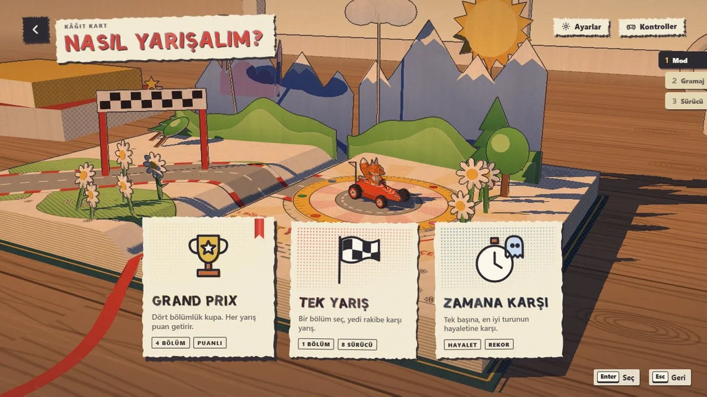
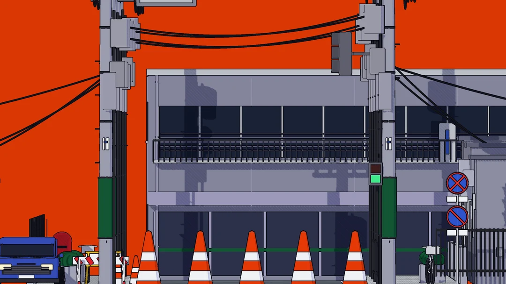
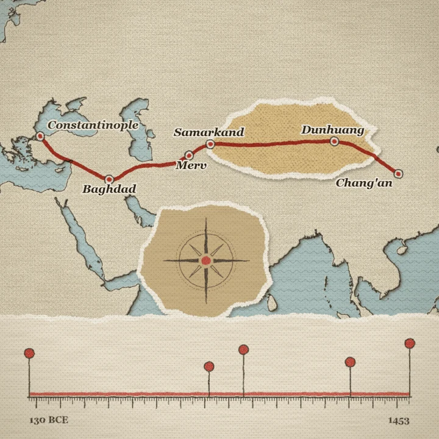
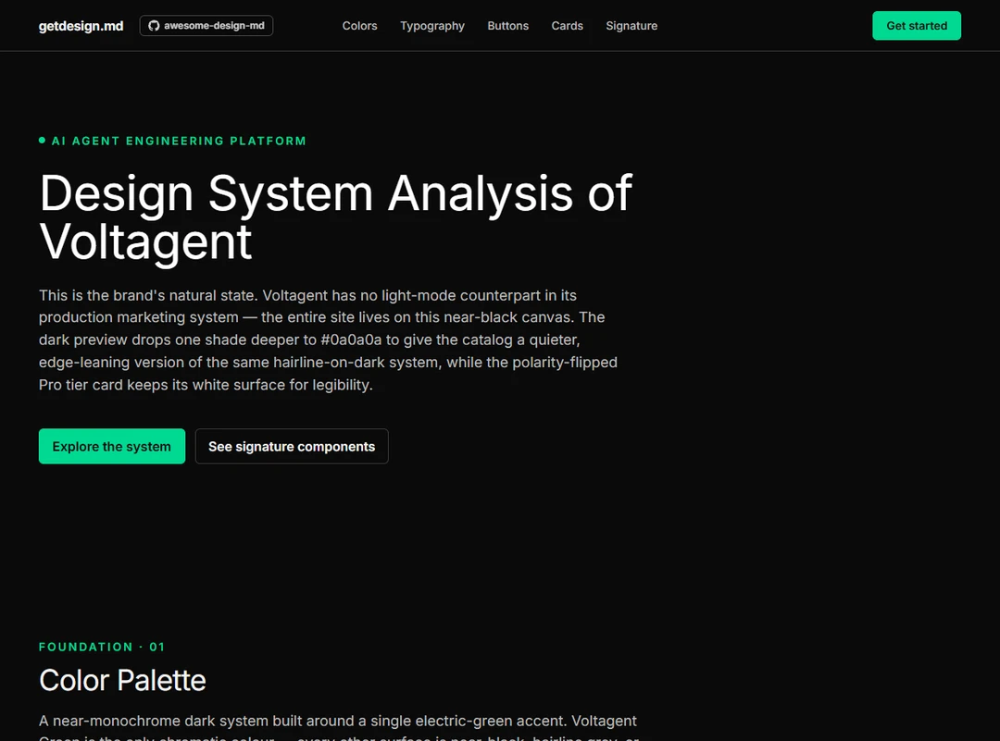
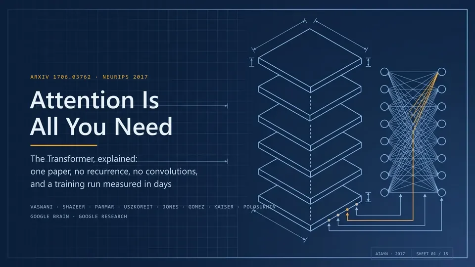
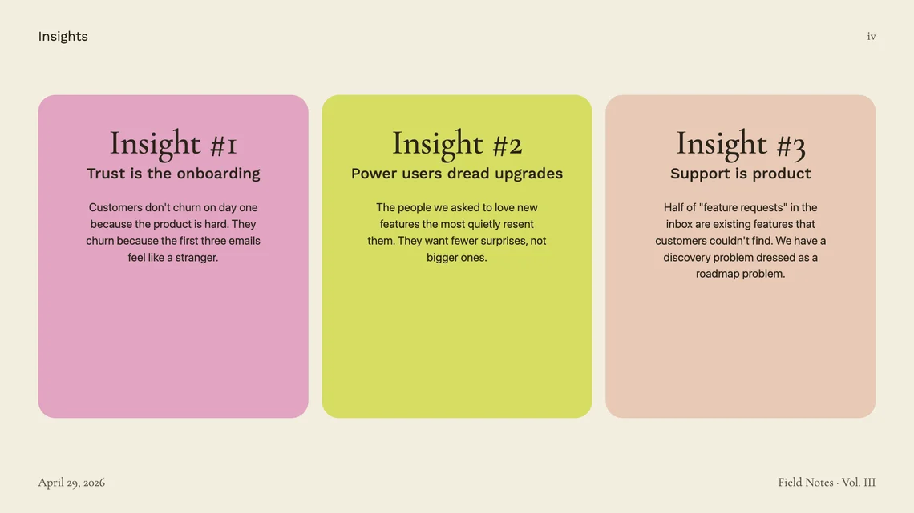
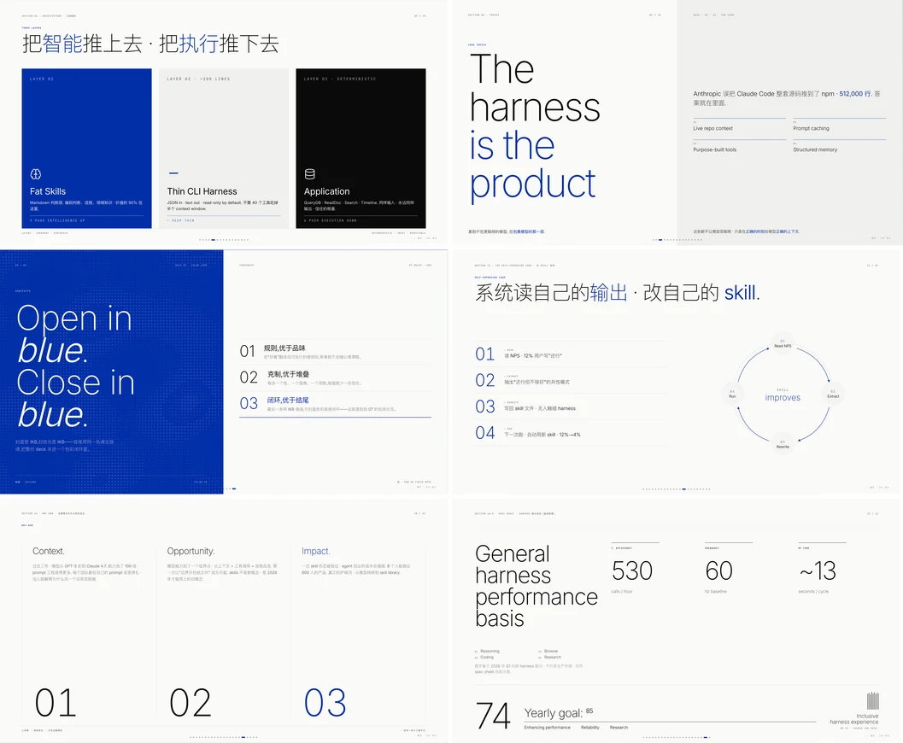

# 热门 Skill 精选

按用途收录可复用的 AI 技能、创作工具与成品案例。各领域按 Stars 从高到低排列，暂无计数的项目排在末尾。点击项目名查看简介和效果图，点击图片可查看上游原图或生成它的模板。

**16 个项目 · 8 个领域**　｜　GitHub Stars 采集于 2026-11-26（北京时间）

| 领域 | 项目 | 类型 | GitHub Stars |
| --- | --- | --- | ---: |
| 游戏开发 | [DSH Game Studio](#project-dsh-game-studio) | 游戏创作插件 | [911](https://github.com/ZSeven-W/dsh-game-studio/stargazers) |
|  | [Kâğıt Kart](#project-kagit-kart) | 可玩游戏案例 | [20](https://github.com/BurakErdemci/kagit-kart/stargazers) |
| 视频制作 | [FFmpeg Skill](#project-ffmpeg-skill) | 剪辑 Skill | [10,980](https://github.com/kajisho5/ffmpeg-skill/stargazers) |
|  | [Remotion Agent Skills](#project-remotion-skills) | 官方 Skill 合集 | [7,995](https://github.com/remotion-dev/skills/stargazers) |
|  | [SRT 白板动画](#project-srt-whiteboard-animation) | 手绘动画 Skill | [5,834](https://github.com/geeklee/srt-whiteboard-animation/stargazers) |
|  | [Perspective Illusion](#project-perspective-illusion) | 透视动画 Skill | [556](https://github.com/dotslashsimran/simcraft/stargazers)（所属仓库） |
| 视觉创作与仿真 | [Teardown](#project-teardown) | 交互仿真 Skill | [4,164](https://github.com/elvarofficial/teardown/stargazers) |
|  | [Creator Generalist](#project-creator-generalist) | 创作 Skill 合集 | [369](https://github.com/codepawl/creator-generalist/stargazers) |
| UI 与设计系统 | [Awesome DESIGN.md](#project-awesome-design-md) | 设计规范合集 | [129,032](https://github.com/VoltAgent/awesome-design-md/stargazers) |
| 演示文稿 | [PPT Master](#project-ppt-master) | PowerPoint 生成 Skill | [80,167](https://github.com/hugohe3/ppt-master/stargazers) |
|  | [Frontend Slides](#project-frontend-slides) | HTML 演示 Skill | [32,903](https://github.com/zarazhangrui/frontend-slides/stargazers) |
|  | [归藏 PPT Skill](#project-guizang-ppt-skill) | HTML 演示 Skill | [30,416](https://github.com/op7418/guizang-ppt-skill/stargazers) |
| 地图与城市可视化 | [Pocket City](#project-pocket-city) | 城市建模 Skill | — |
| 桌面交互 | [DSH Pet](#project-dsh-pet) | 桌宠插件 | [6,722](https://github.com/PC2005-cloud/dsh-pet/stargazers) |
|  | [KuroCat](#project-kurocat) | 桌宠工具 | [932](https://github.com/qianyiai/kurocat/stargazers) |
| 传统文化与知识库 | [紫微斗数](#project-ziwei-doushu) | 排盘引擎与数据集 | [19,660](https://github.com/Renhuai123/ziwei-doushu/stargazers) |

## 游戏开发

### DSH Game Studio

用一句话描述玩法，先在 DeepSeek Harness 侧栏试玩 2D 或 3D 小游戏，再替换角色和场景素材。项目可以发布到 GitHub Pages 或 Cloudflare。

[项目主页](https://github.com/ZSeven-W/dsh-game-studio) · [浏览作品墙](https://finiking.github.io/dsh-games/wall/)

| 月夜森林中的 2D 收集游戏 | 同一只狐狸的 3D 体素岛屿关卡 |
| --- | --- |
|  |  |

### Kâğıt Kart

把浏览器赛车做成一本立体书。赛车驶近时，桥梁和建筑从书页上折起；纸车、赛道纹理和音效均由代码生成。

[项目主页](https://github.com/BurakErdemci/kagit-kart/tree/master) · [在线试玩](https://burakerdemci.github.io/kagit-kart/)

| 立体书展开后的游戏菜单 | 冰川赛道上的漂移加速 |
| --- | --- |
|  |  |

## 视频制作

### FFmpeg Skill

让编程助手在本机调用 FFmpeg，把长素材剪成短片、添加逐词高亮字幕，或把同一段横屏视频重构为竖屏。

[项目主页](https://github.com/kajisho5/ffmpeg-skill) · [观看剪辑演示](https://kajisho5.github.io/ffmpeg-skill/#showcase)

| 逐词高亮字幕演示 | 横屏转竖屏的裁切对照 |
| --- | --- |
|  |  |

### Remotion Agent Skills

用 React 编排视频。助手可创建合成、安排动画节奏、添加字幕和地图，再启动 Remotion Studio 检查时间线并渲染成片。

[项目主页](https://github.com/remotion-dev/skills) · [查看提示词与作品](https://www.remotion.dev/prompts)

| 官方教程中的 Studio 视频预览与剪辑时间线 |
| --- |
|  |

### SRT 白板动画

把 SRT 字幕拆成分镜，用字幕的时间轴安排画面元素依次下笔、上色。可以在浏览器预览台调整绘制顺序和时序，再导出 MP4，适合课程和知识讲解视频。

[项目主页](https://github.com/geeklee/srt-whiteboard-animation)

| 猴子山抢香蕉 · 随字幕落笔并上色 | 同一场景的原始线稿 |
| --- | --- |
|  |  |

### Perspective Illusion

用同一条街演出平面插画与立体空间之间的切换。模板通过推拉变焦和相机绕行让纵深显现，可输出无缝循环视频。

[项目主页](https://github.com/dotslashsimran/simcraft/tree/main/skills/video/perspective-illusion)

此 Skill 位于 simcraft 的子目录，Stars 为整个 simcraft 仓库的计数。

| 街景模板实渲帧 · 0.30 秒，长焦压缩纵深 | 街景模板实渲帧 · 2.33 秒，转角视图展开 |
| --- | --- |
|  |  |

## 视觉创作与仿真

### Teardown

把机械原理做成可离线打开的交互式 3D 网页。读者可以在机器运转时展开零件，观察部件动作及其对应的仪表读数。

[项目主页](https://github.com/elvarofficial/teardown)

| 机械蜂模拟器 | 机械章鱼模拟器 |
| --- | --- |
|  |  |

### Creator Generalist

为 2D 解说、3D 动画和游戏原型提供不同的制作流程。作者用同一套工具做出了带传动结构的水磨剖面，以及按年代展开的丝绸之路地图。

[项目主页](https://github.com/codepawl/creator-generalist)

| 水磨剖面与传动结构 | 丝绸之路地图动画 |
| --- | --- |
|  |  |

## UI 与设计系统

### Awesome DESIGN.md

把品牌网站的颜色、字体、间距、组件和布局规则整理成可复用的 DESIGN.md。放进项目后，编程助手可按同一套设计规范生成页面和组件。

[项目主页](https://github.com/VoltAgent/awesome-design-md) · [浏览设计目录](https://getdesign.md/design-md)

| VoltAgent 样例 · 深色界面与绿色按钮 | Notion 样例 · 浅色界面与色板 |
| --- | --- |
|  |  |

## 演示文稿

### PPT Master

把文档或主题整理成可以在 PowerPoint 里继续编辑的 PPTX，支持原生图表、动画、讲稿配音，也可以沿用自己的 PPTX 模板。

[项目主页](https://github.com/hugohe3/ppt-master) · [在线浏览作品](https://hugohe3.github.io/ppt-master-examples/)

| 像素风《中国早餐图鉴》 | 技术蓝图风格的 Transformer 论文解读 |
| --- | --- |
|  |  |

### Frontend Slides

从主题生成浏览器里可翻页的单文件 HTML，也能把现有 PowerPoint 转成网页幻灯片。先给出多套视觉预览供挑选，再沿选定的风格完成整份演示。

[项目主页](https://github.com/zarazhangrui/frontend-slides) · [浏览模板画廊](https://github.com/zarazhangrui/frontend-slides#bold-template-gallery)

| Soft Editorial · 编辑式卡片布局 | Cobalt Grid · 钴蓝网格封面 |
| --- | --- |
|  |  |

### 归藏 PPT Skill

用电子杂志或瑞士国际主义两套版式生成单文件 HTML 幻灯片，也能制作配图与社媒封面。演讲者模式显示讲稿和下一页预览，并提供计时排练。

[项目主页](https://github.com/op7418/guizang-ppt-skill) · [查看版式与演示](https://github.com/op7418/guizang-ppt-skill#%E6%95%88%E6%9E%9C)

| 电子杂志风格作品集 | 瑞士国际主义风格版式示例 |
| --- | --- |
|  |  |

## 地图与城市可视化

### Pocket City

把现实中的一小片街区绘成可旋转的等距微缩模型。官网可以探索阿姆斯特丹的运河与桥梁，也提供生成其他街区的 Skill 下载。

[项目主页](https://april-zhu.com/pocketcity) · [下载 Skill（ZIP）](https://april-zhu.com/pocketcity/skill/pocket-city.zip)

Stars 暂缺。项目官网未提供对应的公开 GitHub 仓库链接。

| 波托菲诺港口的等距微缩模型 |
| --- |
|  |

## 桌面交互

### DSH Pet

让透明动画桌宠在桌面或 DSH 网页中活动。可以多开、调整大小与位置，也可以把自制 AI 视频加工成宠物动作。

[项目主页](https://github.com/PC2005-cloud/dsh-pet)

| 宠物在 DSH 界面中的运行效果 | 自定义动作示例 · 吃白饭 |
| --- | --- |
|  |  |

### KuroCat

透明置顶的桌面打字猫，按键和鼠标动作会触发动画。可切换 2D 手绘和 3D 立体模式，作为 OBS 透明浏览器源，也能通过 MCP 定制角色。

[项目主页](https://github.com/qianyiai/kurocat) · [官网在线试玩](https://qianyi.one/kurocat/)

| 3D 桌宠与打字动画 | 65% 与 108 键键盘的双视角对比 |
| --- | --- |
|  |  |

## 传统文化与知识库

### 紫微斗数

按倪海厦《天纪》体系整理传统紫微斗数的排盘算法、四化规则、古籍和命例。可在线查看排盘，也可按课程图例对照研读。

[项目主页](https://github.com/Renhuai123/ziwei-doushu) · [在线排盘](https://ouranic.cn/?from=gh-readme)

| 课程命例 · 命宫甲午的十二宫排布 |
| --- |
|  |

## 扩充索引

1. 在 [catalog.json](catalog.json) 的 `projects` 中复制一条相近的记录，填写唯一的 `id`、领域、类型、简介和项目链接。`repo` 填 GitHub 的 `owner/repo`，官网项目可填 `null`。收录子目录时，用 `starNote` 注明 Stars 归属。
2. 将 1–3 张效果图放进 [previews/](previews/)，在 `images` 中填写相对路径、中文图注和上游来源。相同的 `category` 会自动归为一组。
3. 使用 Node.js 20 或更高版本，在仓库根目录运行 `node scripts/catalog.mjs --refresh-stars`，统一更新 Stars 和首页。只修改文字或图片时，运行 `node scripts/catalog.mjs` 即可离线重建。将数据、图片和 README 一起提交。
