# 热门 Skill 精选

按用途收录可复用的 AI 技能、创作工具与成品案例。各领域按 Stars 从高到低排列，暂无计数的项目排在末尾。点击项目名查看项目链接和效果图，点击图片可查看上游原图或生成它的模板。

**19 个项目 · 8 个领域**　｜　GitHub Stars 采集于 2026-11-28（北京时间）

| 领域 | 项目 | 简介 | GitHub Stars |
| --- | --- | --- | ---: |
| 游戏开发 | [DSH Game Studio](#project-dsh-game-studio) | 用一句话描述玩法，生成可试玩的 2D 或 3D 小游戏。换好角色和场景后，可以发链接邀请别人玩。 | [994](https://github.com/ZSeven-W/dsh-game-studio/stargazers) |
|  | [Kâğıt Kart](#project-kagit-kart) | 打开网页就能玩纸片卡丁车。漂移竞速时，桥梁和建筑会随着赛车靠近从书页上立起。 | [22](https://github.com/BurakErdemci/kagit-kart/stargazers) |
| 视频制作 | [OpenMotion](#project-openmotion) | 根据参考视频做出自己的版本，换上品牌配色、文案和素材，再逐段调整镜头和节奏。适合制作产品介绍或社媒短片。 | [17,127](https://github.com/nexu-io/openmotion/stargazers) |
|  | [FFmpeg Skill](#project-ffmpeg-skill) | 把现有视频剪成可发布的短片，去掉静音段、加逐词高亮字幕，也能把横屏素材裁成适合社媒发布的竖屏。 | [12,191](https://github.com/kajisho5/ffmpeg-skill/stargazers) |
|  | [Remotion Agent Skills](#project-remotion-skills) | 把文案、图片和数据做成带动画的产品介绍、片头或地图解说。先预览节奏和字幕，再导出视频。 | [8,240](https://github.com/remotion-dev/skills/stargazers) |
|  | [SRT 白板动画](#project-srt-whiteboard-animation) | 把课程或口播字幕做成手绘解说视频。线条和颜色跟着讲解逐步出现，让观众边听边看重点。 | [5,900](https://github.com/geeklee/srt-whiteboard-animation/stargazers) |
|  | [Vox Director](#project-vox-director) | 给出一个选题，做成带旁白、配乐和字幕的剪纸拼贴短片。适合讲历史、讲知识，或用一条短片介绍产品卖点。 | [3,253](https://github.com/Alisa0808/vox-director/stargazers) |
|  | [Perspective Illusion](#project-perspective-illusion) | 做出一段可循环播放的视觉错觉视频。街景先像平面插画，镜头移动时显出纵深，适合做创意短片或片头。 | [575](https://github.com/dotslashsimran/simcraft/stargazers)（所属仓库） |
| 视觉创作与仿真 | [Teardown](#project-teardown) | 把机械装置做成可拆开的网页演示。可以边看机器运转，边展开部件或查看仪表，用来讲解零件怎样配合。 | [4,358](https://github.com/elvarofficial/teardown/stargazers) |
|  | [Creator Generalist](#project-creator-generalist) | 把创意做成动画解说、角色展示或可试玩的游戏原型，例如会运转的水磨剖面和逐段展开的丝绸之路地图。 | [378](https://github.com/codepawl/creator-generalist/stargazers) |
| UI 与设计系统 | [Awesome DESIGN.md](#project-awesome-design-md) | 从现成的界面示例里挑一套视觉风格，让助手做出配色、按钮和排版一致的网站。适合给新站或改版定风格。 | [129,550](https://github.com/VoltAgent/awesome-design-md/stargazers) |
|  | [Text to Lottie](#project-text-to-lottie) | 用文字描述动作，把图标、标志或图形做成可放进网页和 App 的小动画。适合做加载提示、按钮反馈和品牌动效。 | [5,836](https://github.com/diffusionstudio/lottie/stargazers)（所属仓库） |
| 演示文稿 | [PPT Master](#project-ppt-master) | 把报告或主题做成可以在 PowerPoint 里继续修改的幻灯片。文字和图表能逐项编辑，也可以沿用自己的演示模板。 | [80,939](https://github.com/hugohe3/ppt-master/stargazers) |
|  | [Frontend Slides](#project-frontend-slides) | 把一个主题或已有的 PowerPoint 做成能在浏览器翻页的演示。可以先看几种风格再选，做好后把网页文件发给听众。 | [33,053](https://github.com/zarazhangrui/frontend-slides/stargazers) |
|  | [归藏 PPT Skill](#project-guizang-ppt-skill) | 把文章或产品介绍排成杂志式或网格式的网页演示，也能制作配图和分享封面。现场讲解时可看讲稿、下一页和计时。 | [30,552](https://github.com/op7418/guizang-ppt-skill/stargazers) |
| 地图与城市可视化 | [Pocket City](#project-pocket-city) | 给一个真实地址，做出可旋转、缩放和切换季节的手绘微缩街区。适合展示城市地标，或把熟悉的街角做成可分享的纪念。 | — |
| 桌面交互 | [DSH Pet](#project-dsh-pet) | 让会动的宠物陪在桌面一角。可以同时放几只，调整大小和位置，也能用自制视频给宠物添加新动作。 | [6,810](https://github.com/PC2005-cloud/dsh-pet/stargazers) |
|  | [KuroCat](#project-kurocat) | 桌角的小猫会模仿你敲键盘和点鼠标，也可以换造型。直播时可以把小猫放进画面，让观众看见它的反应。 | [1,915](https://github.com/qianyiai/kurocat/stargazers) |
| 传统文化与知识库 | [紫微斗数](#project-ziwei-doushu) | 用出生信息生成传统紫微斗数命盘，查看宫位和星曜分布，也可以对照古籍和课程命例学习排盘。 | [19,978](https://github.com/Renhuai123/ziwei-doushu/stargazers) |

## 游戏开发

### DSH Game Studio

用一句话描述玩法，生成可试玩的 2D 或 3D 小游戏。换好角色和场景后，可以发链接邀请别人玩。

[项目主页](https://github.com/ZSeven-W/dsh-game-studio) · [浏览作品墙](https://finiking.github.io/dsh-games/wall/)

| 月夜森林中的 2D 收集游戏 | 同一只狐狸的 3D 体素岛屿关卡 |
| --- | --- |
| <a href="https://github.com/ZSeven-W/dsh-game-studio/blob/7d7630bfe1320327befb766501559893540ca782/docs/images/dsh-game-studio-play-moonlit-2d.jpg">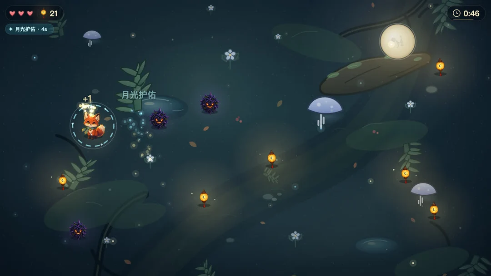</a> | <a href="https://github.com/ZSeven-W/dsh-game-studio/blob/7d7630bfe1320327befb766501559893540ca782/docs/images/dsh-game-studio-play-fox-3d.jpg">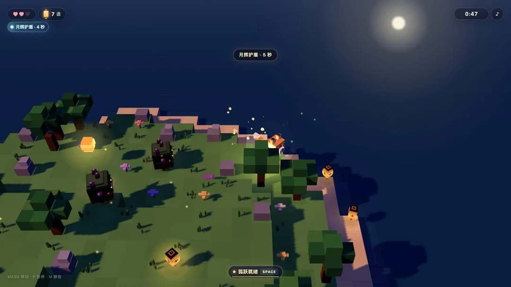</a> |

### Kâğıt Kart

打开网页就能玩纸片卡丁车。漂移竞速时，桥梁和建筑会随着赛车靠近从书页上立起。

[项目主页](https://github.com/BurakErdemci/kagit-kart/tree/master) · [在线试玩](https://burakerdemci.github.io/kagit-kart/)

| 立体书展开后的游戏菜单 | 冰川赛道上的漂移加速 |
| --- | --- |
|  | <a href="https://github.com/BurakErdemci/kagit-kart/blob/ae500d99d5ba2359d4bb52853e97c244c0ea182a/docs/shots/glacier-drift.jpg">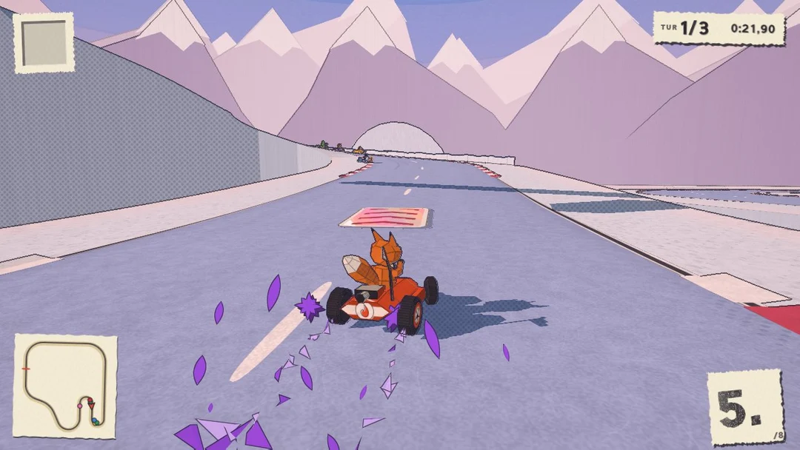</a> |

## 视频制作

### OpenMotion

根据参考视频做出自己的版本，换上品牌配色、文案和素材，再逐段调整镜头和节奏。适合制作产品介绍或社媒短片。

[项目主页](https://github.com/nexu-io/openmotion) · [查看官网演示](https://open-design.ai/motion/)

| 参考视频、改作画面与编辑时间线 | Notion 产品介绍样例 · 任务卡片动效 |
| --- | --- |
| <a href="https://github.com/nexu-io/openmotion/blob/05a28737dc8e12da3909219b81eda812c99a112e/docs/readme/capcut-claude-motion-cover.zh-CN.webp">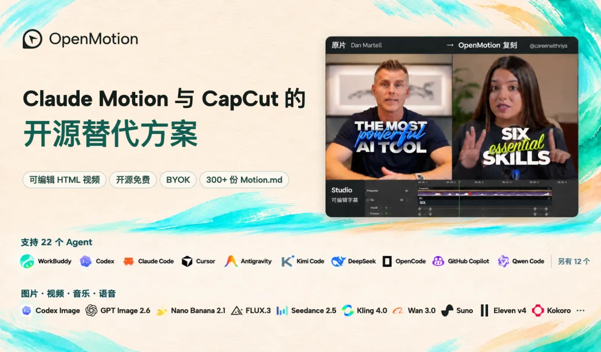</a> | <a href="https://releases.open-design.ai/open-motion/media/sha256/b62ffb99195f35396b6ec0b5f8f0abb8552ffd2493a5e982e5e10fd640c44a0f.gif">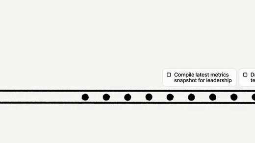</a> |

### FFmpeg Skill

把现有视频剪成可发布的短片，去掉静音段、加逐词高亮字幕，也能把横屏素材裁成适合社媒发布的竖屏。

[项目主页](https://github.com/kajisho5/ffmpeg-skill) · [观看剪辑演示](https://kajisho5.github.io/ffmpeg-skill/#showcase)

| 逐词高亮字幕演示 | 横屏转竖屏的裁切对照 |
| --- | --- |
|  | <a href="https://github.com/kajisho5/ffmpeg-skill/blob/c7dad34c846099e7cf606ef943abe5e12d1ab0f9/docs/demos/reframe_crop.gif">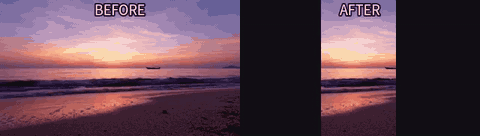</a> |

### Remotion Agent Skills

把文案、图片和数据做成带动画的产品介绍、片头或地图解说。先预览节奏和字幕，再导出视频。

[项目主页](https://github.com/remotion-dev/skills) · [查看提示词与作品](https://www.remotion.dev/prompts)

| 官方教程中的 Studio 视频预览与剪辑时间线 |
| --- |
| <a href="https://www.remotion.dev/img/your-first-video-roller-ski-wide.webp">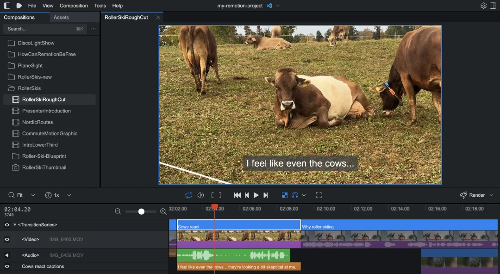</a> |

### SRT 白板动画

把课程或口播字幕做成手绘解说视频。线条和颜色跟着讲解逐步出现，让观众边听边看重点。

[项目主页](https://github.com/geeklee/srt-whiteboard-animation)

| 猴子山抢香蕉 · 随字幕落笔并上色 | 同一场景的原始线稿 |
| --- | --- |
|  | <a href="https://github.com/geeklee/srt-whiteboard-animation/blob/696a7243c0e6ffb6827676e539c2ca5ebae2bf6b/examples/scene-01-monkey-mountain.png">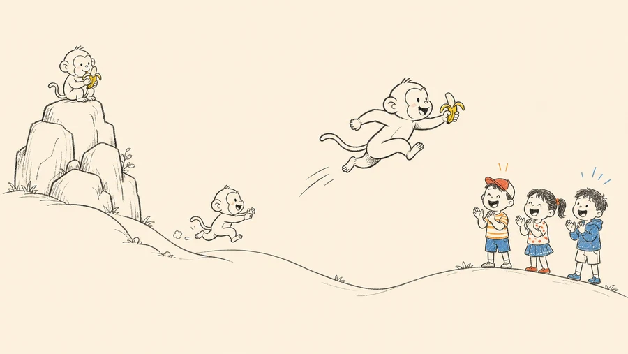</a> |

### Vox Director

给出一个选题，做成带旁白、配乐和字幕的剪纸拼贴短片。适合讲历史、讲知识，或用一条短片介绍产品卖点。

[项目主页](https://github.com/Alisa0808/vox-director) · [观看《货币简史》样片](https://github.com/Alisa0808/vox-director/blob/main/assets/showcase-money.mp4)

| 《货币简史》样片 · 物物交换 | 足球发展史样片 · 早期比赛规则 |
| --- | --- |
| <a href="https://github.com/Alisa0808/vox-director/blob/6a85a7c341610442a6a5b1885e6e0217ab82a11f/assets/thumbs/money.jpg">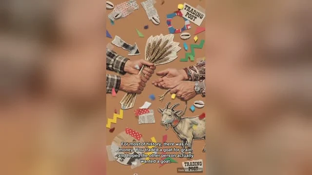</a> | <a href="https://github.com/Alisa0808/vox-director/blob/6a85a7c341610442a6a5b1885e6e0217ab82a11f/assets/thumbs/football.jpg">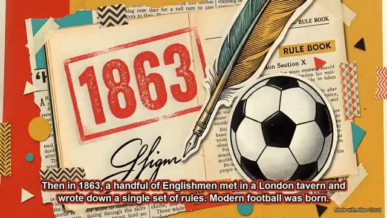</a> |

### Perspective Illusion

做出一段可循环播放的视觉错觉视频。街景先像平面插画，镜头移动时显出纵深，适合做创意短片或片头。

[项目主页](https://github.com/dotslashsimran/simcraft/tree/main/skills/video/perspective-illusion)

此 Skill 位于 simcraft 的子目录，Stars 为整个 simcraft 仓库的计数。

| 街景模板实渲帧 · 0.30 秒，长焦压缩纵深 | 街景模板实渲帧 · 2.33 秒，转角视图展开 |
| --- | --- |
|  | <a href="https://github.com/dotslashsimran/simcraft/blob/58224d131814572224537fb516b8c5d33dd5fa67/skills/video/perspective-illusion/templates/street_plus.html">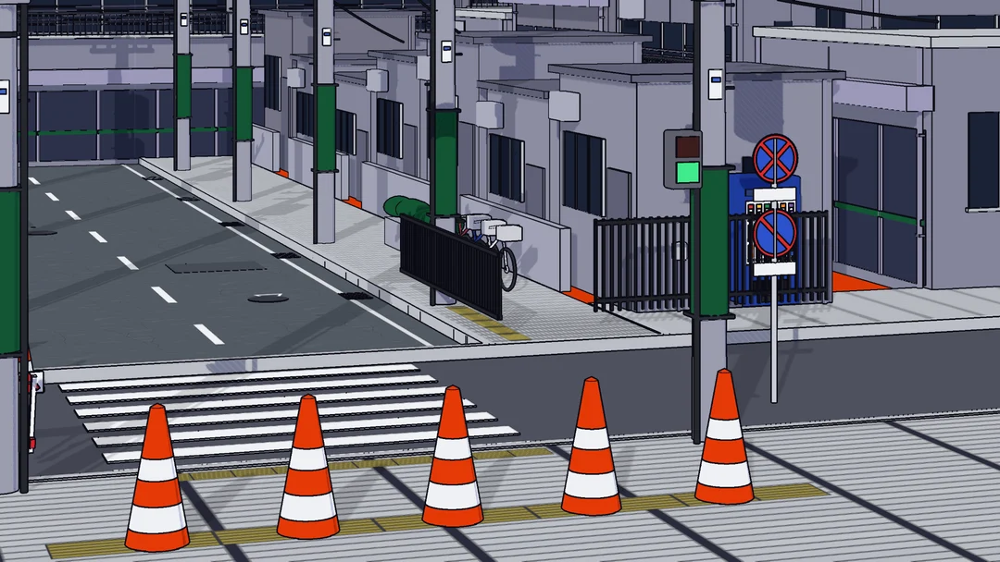</a> |

## 视觉创作与仿真

### Teardown

把机械装置做成可拆开的网页演示。可以边看机器运转，边展开部件或查看仪表，用来讲解零件怎样配合。

[项目主页](https://github.com/elvarofficial/teardown)

| 机械蜂模拟器 | 机械章鱼模拟器 |
| --- | --- |
| <a href="https://github.com/elvarofficial/teardown/blob/a91262ac1109051e014662d42ecb0b7bc1f113b1/docs/bee.gif">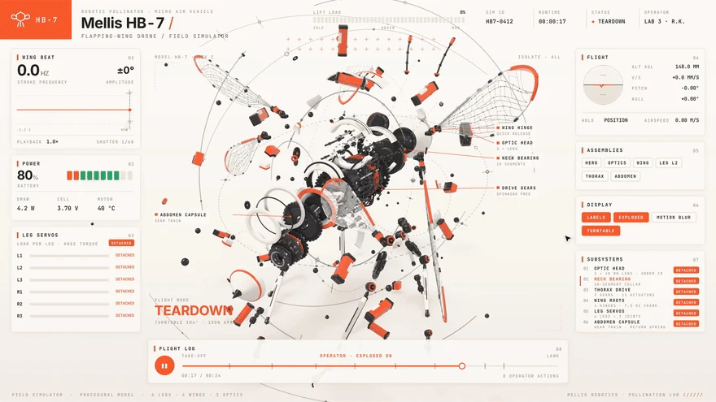</a> | <a href="https://github.com/elvarofficial/teardown/blob/a91262ac1109051e014662d42ecb0b7bc1f113b1/docs/octopus.gif">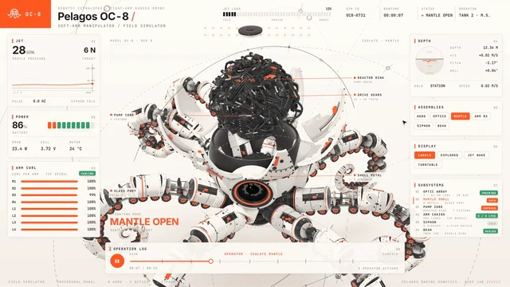</a> |

### Creator Generalist

把创意做成动画解说、角色展示或可试玩的游戏原型，例如会运转的水磨剖面和逐段展开的丝绸之路地图。

[项目主页](https://github.com/codepawl/creator-generalist)

| 水磨剖面与传动结构 | 丝绸之路地图动画 |
| --- | --- |
| <a href="https://github.com/codepawl/creator-generalist/blob/fd244459e21f364d7384c460e7965e1aff211791/assets/mill.gif">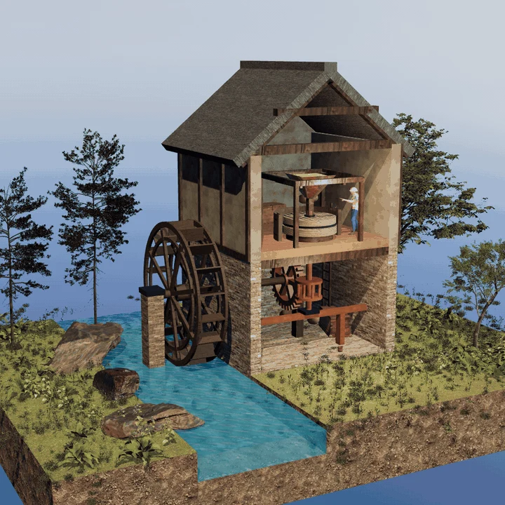</a> |  |

## UI 与设计系统

### Awesome DESIGN.md

从现成的界面示例里挑一套视觉风格，让助手做出配色、按钮和排版一致的网站。适合给新站或改版定风格。

[项目主页](https://github.com/VoltAgent/awesome-design-md) · [浏览设计目录](https://getdesign.md/design-md)

| VoltAgent 样例 · 深色界面与绿色按钮 | Notion 样例 · 浅色界面与色板 |
| --- | --- |
|  | <a href="https://getdesign.md/design-md/notion/preview">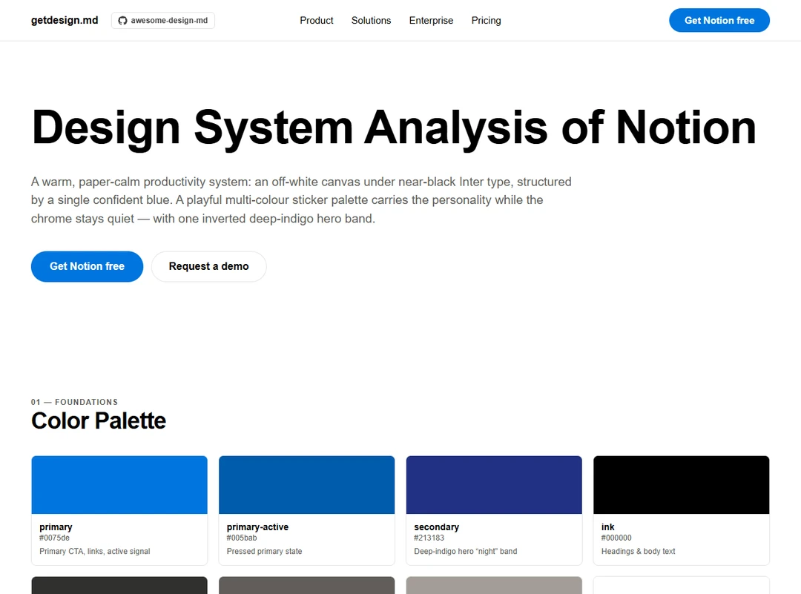</a> |

### Text to Lottie

用文字描述动作，把图标、标志或图形做成可放进网页和 App 的小动画。适合做加载提示、按钮反馈和品牌动效。

[项目主页](https://github.com/diffusionstudio/lottie/tree/main/skills/text-to-lottie) · [查看官方动效示例](https://github.com/diffusionstudio/lottie#created-with-text-to-lottie)

此 Skill 位于 Diffusion Studio 的 lottie 仓库，Stars 为整个仓库的计数。

| Spotify 标志显现与变色动画 | 方块碰撞与计数动画 |
| --- | --- |
| <a href="https://github.com/diffusionstudio/lottie/blob/3c72912fad543897f90045ed4d355813837927fc/assets/demo-1.gif">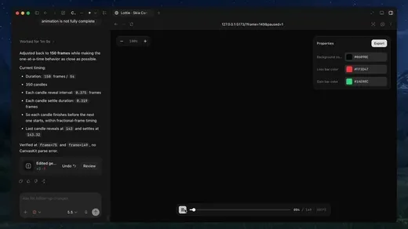</a> | <a href="https://github.com/diffusionstudio/lottie/blob/3c72912fad543897f90045ed4d355813837927fc/assets/demo-2.gif">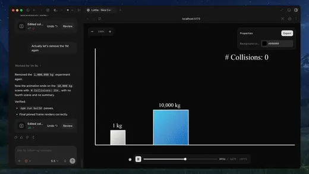</a> |

## 演示文稿

### PPT Master

把报告或主题做成可以在 PowerPoint 里继续修改的幻灯片。文字和图表能逐项编辑，也可以沿用自己的演示模板。

[项目主页](https://github.com/hugohe3/ppt-master) · [在线浏览作品](https://hugohe3.github.io/ppt-master-examples/)

| 像素风《中国早餐图鉴》 | 技术蓝图风格的 Transformer 论文解读 |
| --- | --- |
| <a href="https://github.com/hugohe3/ppt-master/blob/63a03673d5c3c928e7f52983a2c8ec65bac30002/docs/assets/screenshots/preview_pixel_breakfast_atlas.webp">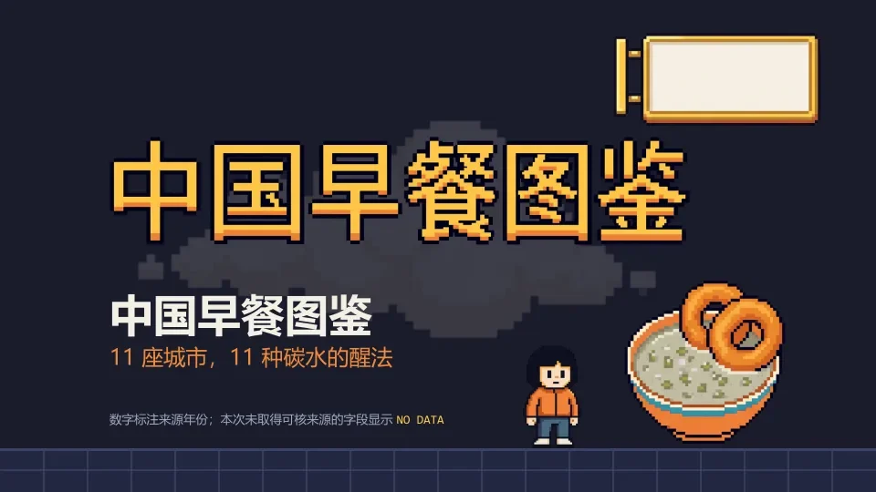</a> |  |

### Frontend Slides

把一个主题或已有的 PowerPoint 做成能在浏览器翻页的演示。可以先看几种风格再选，做好后把网页文件发给听众。

[项目主页](https://github.com/zarazhangrui/frontend-slides) · [浏览模板画廊](https://github.com/zarazhangrui/frontend-slides#bold-template-gallery)

| Soft Editorial · 编辑式卡片布局 | Cobalt Grid · 钴蓝网格封面 |
| --- | --- |
|  | <a href="https://github.com/zarazhangrui/beautiful-html-templates/blob/e5e204fb1f3b06290846e7dcd7aceddabeceec8c/screenshots/cobalt-grid-1.png">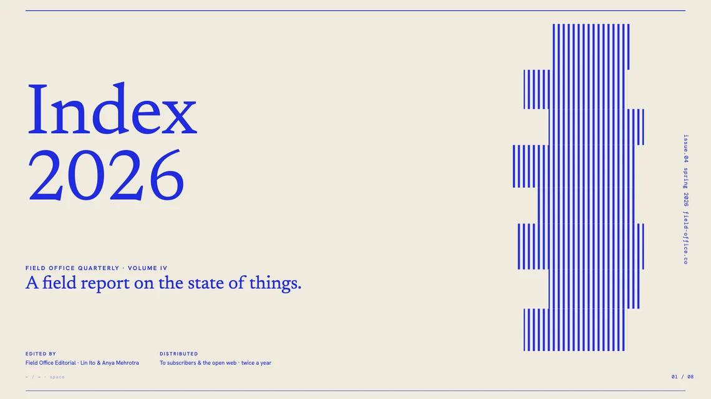</a> |

### 归藏 PPT Skill

把文章或产品介绍排成杂志式或网格式的网页演示，也能制作配图和分享封面。现场讲解时可看讲稿、下一页和计时。

[项目主页](https://github.com/op7418/guizang-ppt-skill) · [查看版式与演示](https://github.com/op7418/guizang-ppt-skill#%E6%95%88%E6%9E%9C)

| 电子杂志风格作品集 | 瑞士国际主义风格版式示例 |
| --- | --- |
| <a href="https://github.com/op7418/guizang-ppt-skill/blob/93d21bf4a73a851907a6eb00acbf30618236667a/assets/ppt-skill-showcase.png">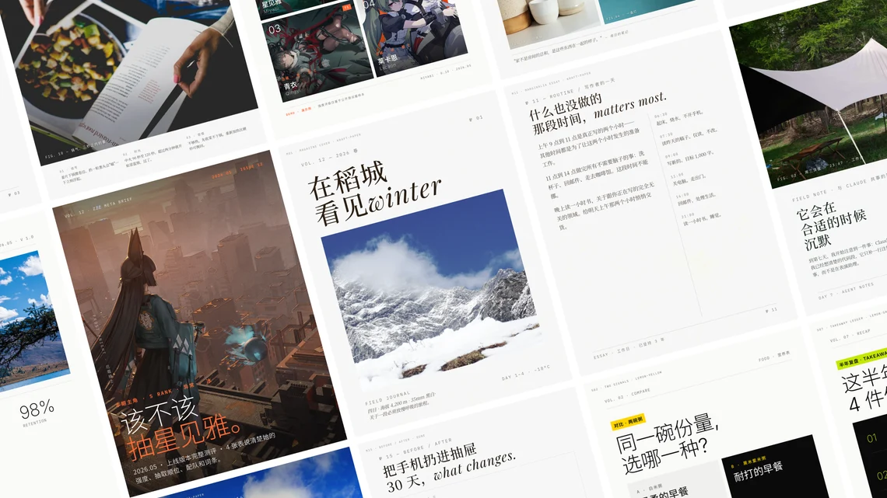</a> |  |

## 地图与城市可视化

### Pocket City

给一个真实地址，做出可旋转、缩放和切换季节的手绘微缩街区。适合展示城市地标，或把熟悉的街角做成可分享的纪念。

[项目主页](https://april-zhu.com/pocketcity) · [下载 Skill（ZIP）](https://april-zhu.com/pocketcity/skill/pocket-city.zip)

Stars 暂缺。项目官网未提供对应的公开 GitHub 仓库链接。

| 波托菲诺港口的等距微缩模型 |
| --- |
| <a href="https://april-zhu.com/pocketcity/skill/portofino-preview.webp">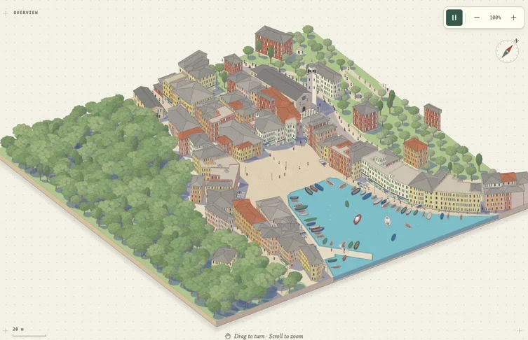</a> |

## 桌面交互

### DSH Pet

让会动的宠物陪在桌面一角。可以同时放几只，调整大小和位置，也能用自制视频给宠物添加新动作。

[项目主页](https://github.com/PC2005-cloud/dsh-pet)

| 宠物在 DSH 界面中的运行效果 | 自定义动作示例 · 吃白饭 |
| --- | --- |
| <a href="https://github.com/PC2005-cloud/dsh-pet/blob/fb38ce620576f5ed3735a99536d2b1a4a9eb313f/assets/screenshots/dsh-pet-running-1.png">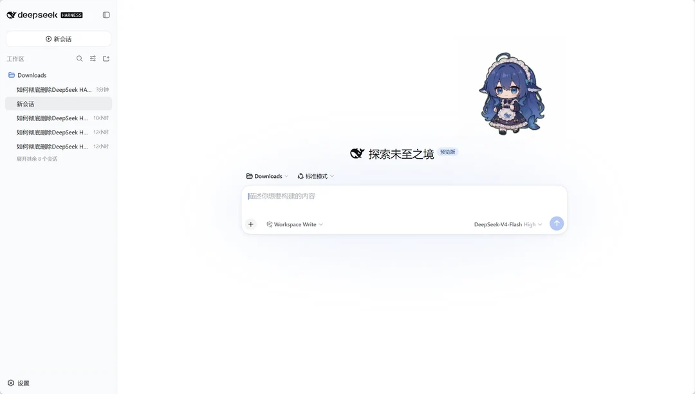</a> |  |

### KuroCat

桌角的小猫会模仿你敲键盘和点鼠标，也可以换造型。直播时可以把小猫放进画面，让观众看见它的反应。

[项目主页](https://github.com/qianyiai/kurocat) · [官网在线试玩](https://qianyi.one/kurocat/)

| 3D 桌宠与打字动画 | 65% 与 108 键键盘的双视角对比 |
| --- | --- |
|  | <a href="https://github.com/qianyiai/kurocat/blob/c3010dedf61b25c908922e958986e60339659e84/website/public/assets/showcase-108key.webp">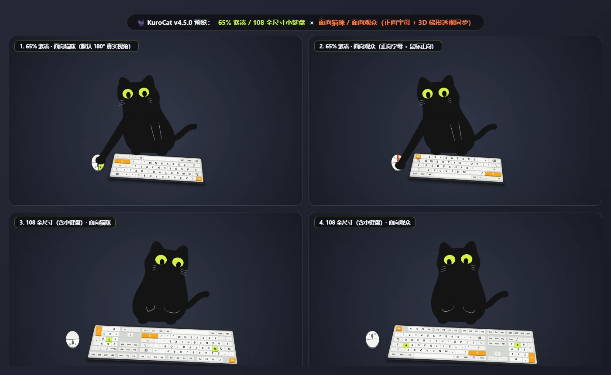</a> |

## 传统文化与知识库

### 紫微斗数

用出生信息生成传统紫微斗数命盘，查看宫位和星曜分布，也可以对照古籍和课程命例学习排盘。

[项目主页](https://github.com/Renhuai123/ziwei-doushu) · [在线排盘](https://ouranic.cn/?from=gh-readme)

| 课程命例 · 命宫甲午的十二宫排布 |
| --- |
| <a href="https://github.com/Renhuai123/ziwei-doushu/blob/a857a4fc2c2950cf27c8e4818c77a7090ad1c434/research/nishi-video-reading/%E5%BA%B7%E5%A5%88%E5%B0%94%E7%AC%94%E8%AE%B0/P09/%E5%9B%BE/%E5%91%BD%E7%9B%98-P09-%E5%91%BD%E5%AE%AB%E7%94%B2%E5%8D%88.svg">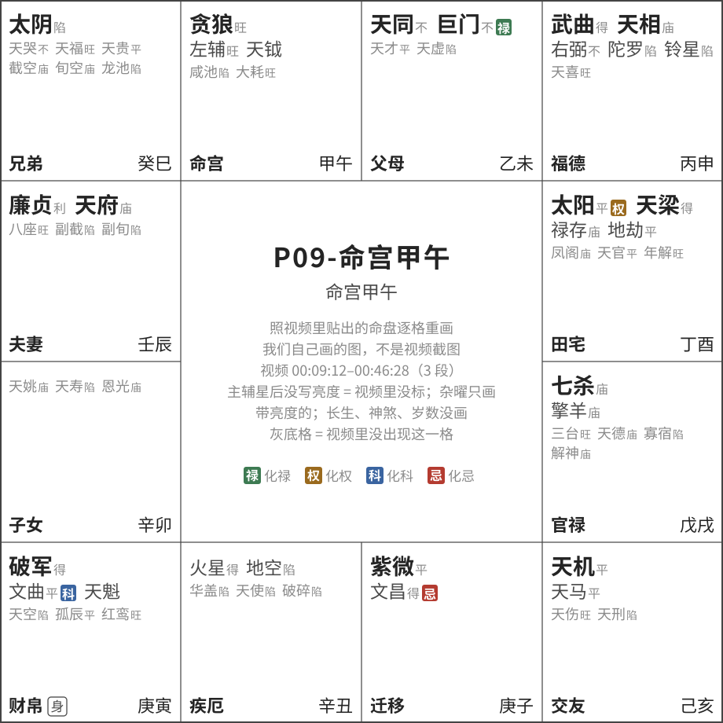</a> |

## 扩充索引

1. 在 [catalog.json](catalog.json) 的 `projects` 中复制一条相近的记录，填写唯一的 `id`、领域、简介和项目链接。简介用一两句写明能做出什么、可以用在什么场景。`repo` 填 GitHub 的 `owner/repo`，官网项目可填 `null`。收录子目录时，用 `starNote` 注明 Stars 归属。
2. 将 1–3 张效果图放进 [previews/](previews/)，在 `images` 中填写相对路径、中文图注和上游来源。相同的 `category` 会自动归为一组。
3. 使用 Node.js 20 或更高版本，在仓库根目录运行 `node scripts/catalog.mjs --refresh-stars`，统一更新 Stars 和首页。只修改文字或图片时，运行 `node scripts/catalog.mjs` 即可离线重建。将数据、图片和 README 一起提交。
